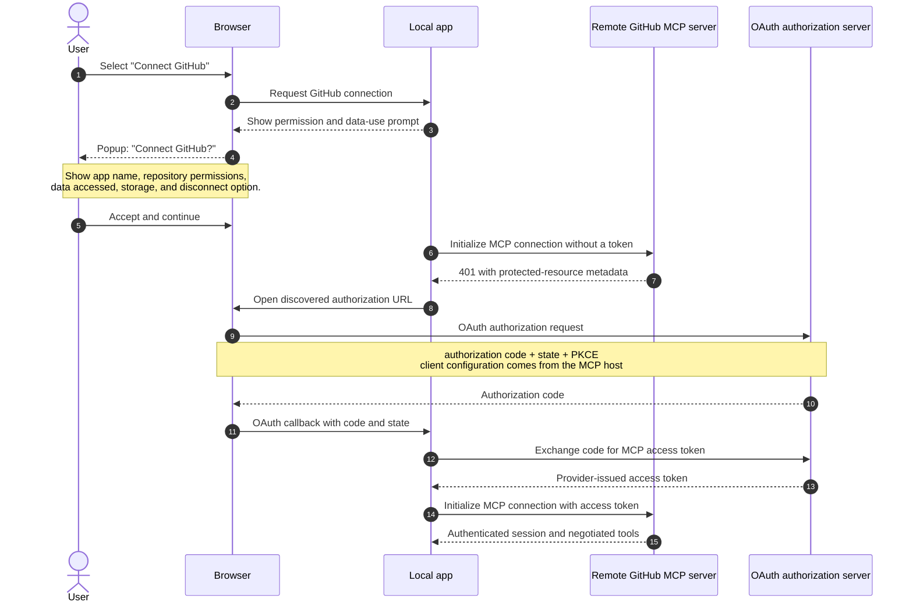
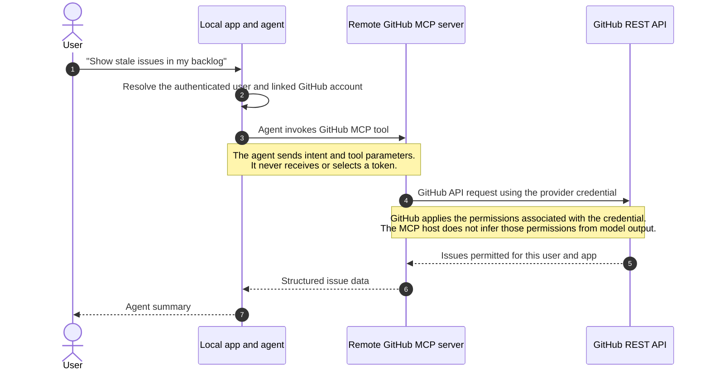

# Identity and delegated capability design

## Production question

Whose authority is the agent using, and how can it act without receiving more privilege than the user has?

## Learning objectives

After studying this chapter, a student should be able to:

1. **Explain** why an agent should use delegated, least-privilege authority instead of a broad service credential.
2. **Distinguish** authentication, authorization, delegation, access tokens, and MCP tool access.
3. **Trace** a remote MCP OAuth flow from user authorization to an MCP request.
4. **Describe** how a permission intersection is limited by user access, application permissions, resource scope, and enabled capabilities.
5. **Apply** the pattern by building a read-only identity step and extending it to a controlled issue-management action with approval.

## Core idea

Give the agent delegated authority. Do not give it a privileged service credential.

The application authenticates the user with an identity provider, obtains a delegated credential for a downstream resource, and limits each operation to the permissions that remain after several checks:

- what the user can access;
- what the application or resource provider allows;
- which resources the application is allowed to reach;
- what the current operation requires;
- what the user has approved.

The agent can select or propose a capability. The MCP server and downstream resource enforce authorization. A prompt cannot enforce an access policy.

## Why privileged access fails

A privileged service credential gives the agent more authority than the current user may have. That creates several problems:

- one compromised agent can access data for many users;
- the downstream resource may not know which user requested an action;
- revoking one user's access may not revoke the agent's access;
- audit records may identify only the service, not the human principal;
- prompt injection or an agent error can use authority unrelated to the user's task;
- testing and incident response become harder when the permission boundary is too broad.

Least privilege limits the authority available to a compromised or mistaken component. Delegation also preserves attribution and keeps access aligned with the requesting user's permissions.

Delegation is one control. The application still needs narrow capabilities, approval for consequential actions, token protection, and audit records.

## Zero trust context

Zero trust starts with a simple rule: the system must not trust a component merely because it runs inside the application or on the organization's network. Each request needs an authenticated principal, an intended resource, an allowed operation, and an enforcement point. NIST describes this model in [SP 800-207](https://doi.org/10.6028/NIST.SP.800-207).

In an agent integration:

- the user, application, agent, remote MCP server, and downstream resource are separate principals or trust boundaries;
- the application identifies the user before it invokes the agent;
- the MCP server exposes only the capabilities it is configured to provide;
- the downstream resource checks the user's access, application permissions, and resource scope;
- the agent receives data or a tool result, not a reusable downstream credential.

Zero trust does not mean adding a second login prompt to every request. It means refusing to treat location, application membership, or model instructions as proof of authority.

## Core vocabulary

- **Authentication:** establishing the identity of a user, service, or workload.
- **Authorization:** deciding whether that principal may perform an operation on a resource.
- **Delegation:** allowing an application to act with authority granted by a user while preserving attribution.
- **Least privilege:** granting only the authority required for the task, resource, and time period.
- **Permission intersection:** the shorthand used in this chapter for the access left after user access, application permissions, resource scope, policy, and operation constraints are combined.
- **Authorization code:** a short-lived value returned after the user authorizes an application; the server exchanges it for an access token.
- **User access token:** a provider-issued credential used by a service to call a resource on behalf of the authorized user.

## Tokens in two minutes

An access token is a credential presented to a resource server. The resource server, not the client or the model, decides whether to accept it.

A **JSON Web Token (JWT)** is a compact, URL-safe token format that carries signed claims as a header, payload, and signature. A resource can validate the signature and inspect claims such as `iss`, `aud`, and `exp`. A JWT is still only a credential. The receiving API must validate that it was issued by the expected authority, for the expected audience, and with the required permissions.

Not every access token is a JWT. Some providers issue opaque bearer tokens. The application must use the resource provider's validation and permission model rather than assume that it can parse token claims.

In any OAuth-based integration, the important credentials are:

- **Authorization code:** a short-lived code returned after the user authorizes the application. The server exchanges it for an access token.
- **User access token:** the credential used for downstream API calls on behalf of the user.
- **Refresh token:** an optional server-side credential used to obtain a new access token when the provider issues expiring tokens.

The model receives none of these credentials.

## Example: a local GitHub issue manager

### Scenario

We are building a small local web application that helps a user manage a GitHub issue backlog. The user connects a GitHub account, asks the agent to find stale issues, and may later ask it to draft or create an issue comment.

The application uses:

- an agent running inside the local application;
- GitHub's remote MCP server exposing the configured capabilities;
- an OAuth relationship between the MCP host and the protected MCP resource;
- explicit approval before write actions.

The local application is the MCP host and agent runtime. GitHub's remote MCP server is a separate trust boundary. The host obtains whatever access token the remote-server configuration requires and presents it to the MCP server. The local application must not assume that it owns or can inspect the downstream GitHub credential.

### The permission rule

The remote MCP flow has several separate permission boundaries:

1. The user authorizes the MCP host or its configured OAuth application.
2. The remote MCP server authenticates the host and exposes a configured set of tools.
3. The downstream GitHub credential determines which repositories and operations GitHub will allow.
4. The application may apply its own policy and approval before invoking a write-capable tool.

For a first prototype, use the remote server's read-only configuration and expose only the context, repository, and issue capabilities needed by the exercise. Add write capability only for a defined action, such as creating an issue comment.

The exact downstream token format and storage location depend on the MCP host and OAuth configuration. Treat the credential as provider-managed and do not parse claims unless the provider documents that contract.

## Part 1: authorize the remote MCP server

The user sees the connection prompt before the browser leaves the application. The application explains the remote server, requested capabilities, data accessed, storage, and how to disconnect it. The host should follow the authorization metadata returned by the remote server rather than hard-code provider endpoints.

The MCP host owns the OAuth client flow. The remote MCP server validates the token presented by the host. The host must document which identity the token represents, how it is stored, how it is revoked, and which downstream GitHub permissions it carries.

## Part 2: handle an agent request

The agent runs inside the local application and calls GitHub's remote MCP server. The remote server applies its own authentication and tool policy before making downstream GitHub requests.

The MCP server exposes the tools in its negotiated inventory. The application should allow only the tools needed for the task and should not let the model choose credentials or bypass the remote server's authorization.

## What each credential means

| Credential | Purpose | Where it is used |
| --- | --- | --- |
| Authorization code | Proves that the user completed authorization with the configured OAuth provider | Server-side exchange only |
| MCP access token | Lets the MCP host authenticate to the protected remote MCP resource | MCP client-to-server requests |
| Downstream credential, if separately managed | Lets the remote service call its downstream resource | Remote MCP service boundary |
| Refresh token, if issued | Obtains a new access token | OAuth client or host token storage |

The agent receives structured issue data or a narrowly scoped MCP result. It receives none of these credentials.

## Common mistakes

- **Give the agent a personal access token or broad service credential.** One leaked or misused credential can expose every repository that it can reach, across many users.
- **Put tokens in prompts, memory, client-side state, or ordinary logs.** Those surfaces have more readers and longer retention than the authorization flow requires.
- **Let the model choose the token or repository.** The MCP host and server must derive access from the authenticated session and their permission checks.
- **Request write access before the prototype needs it.** Early write permissions expand the blast radius before the read path and approval experience have been tested.

## Practice plan

The practice has two sequences. The first proves which GitHub user the application is acting for. The second adds issue access and a controlled write.

The exercise uses GitHub's hosted remote MCP server and its documented OAuth flow. Students do not deploy the MCP server or register their own GitHub App. The earlier delegation model explains the authority boundary; the remote server supplies the concrete exercise path.

### Sequence 1: identify the current user

Configure the local application as an MCP host for GitHub's remote server. Use its OAuth flow, keep the server read-only, and expose the context capability needed for identity. Build the smallest agent possible: invoke `get_me` and display the authenticated GitHub user's profile. The current server defines `get_me` with no parameters. Check the negotiated tool inventory because toolset placement can vary by server version.

**Documentation:** [Remote GitHub MCP Server](https://github.com/github/github-mcp-server#remote-github-mcp-server), [remote server configuration](https://github.com/github/github-mcp-server/blob/main/docs/remote-server.md), [host integration and authentication](https://github.com/github/github-mcp-server/blob/main/docs/host-integration.md), [MCP authorization](https://modelcontextprotocol.io/specification/latest/basic/authorization), [GitHub MCP tools](https://github.com/github/github-mcp-server#tools), [`get_me` implementation](https://github.com/github/github-mcp-server/blob/main/pkg/github/context_tools.go).

Test the boundary with a second account and a revoked authorization. The application must never display one user's profile for another user's session.

### Sequence 2: manage repository issues

Enable the remote server's `repos` and `issues` toolsets with read-only access. Ask the agent to list issues for a repository the authenticated user can access. Then test a repository the user cannot access and record which layer rejects the request.

Next, add one controlled write. Let the agent draft an issue comment, show the repository, issue, content, identity, and permission intersection, and require approval immediately before submission. Enable only the smallest write capability required. Test an expired or revoked authorization and an attempted request for another user's repository.

**Documentation:** [GitHub MCP toolsets](https://github.com/github/github-mcp-server#available-toolsets), [server configuration](https://github.com/github/github-mcp-server/blob/main/docs/server-configuration.md), [GitHub issue permissions](https://docs.github.com/en/rest/authentication/permissions-required-for-github-apps), [GitHub user-token permissions](https://docs.github.com/en/apps/creating-github-apps/authenticating-with-a-github-app/generating-a-user-access-token-for-a-github-app).

Record only what the exercise needs: GitHub user identifier, authorization state, MCP calls, issue content, approval, and deletion path. Decide which fields must stay out of model context and ordinary traces.

## Optional enterprise extension: Entra ID and OBO

The local GitHub example teaches delegation without introducing a second identity provider. In an enterprise application, Microsoft Entra ID may authenticate the user and protect the application's API. Microsoft Entra's on-behalf-of flow can then obtain a token for another Entra-protected API.

That token exchange does not produce a GitHub token. GitHub remains a separate authorization domain and requires its own authorization flow or credential. The enterprise application must deliberately link the Entra principal to the verified GitHub user and keep the provider-specific tokens separate.

## Bibliography

1. [OAuth 2.0 Token Exchange, RFC 8693](https://datatracker.ietf.org/doc/html/rfc8693). **IETF standard.** Defines token exchange, delegation, impersonation, actor context, and resource targeting.
2. [OAuth 2.0 Security Best Current Practice, RFC 9700](https://datatracker.ietf.org/doc/html/rfc9700). **IETF best current practice.** Current security guidance for OAuth deployments, token handling, and narrow authorization.
3. NIST. [Zero Trust Architecture, SP 800-207](https://doi.org/10.6028/NIST.SP.800-207). **Government architecture guidance.** Grounds per-request authorization, policy decision points, and policy enforcement points.
4. NIST. [Security and Privacy Controls, SP 800-53 Rev. 5](https://doi.org/10.6028/NIST.SP.800-53r5), especially AC-6 Least Privilege and AC-5 Separation of Duties. **Government control catalog.** Provides institutional control language for privilege and accountability.
5. [Model Context Protocol specification](https://modelcontextprotocol.io/specification/latest). **Protocol specification.** Defines how the agent invokes an MCP capability; it does not define resource authorization or replace policy enforcement.
6. [MCP authorization](https://modelcontextprotocol.io/specification/latest/basic/authorization). **Protocol specification.** Defines the authorization flow for protected MCP resources and the separation between MCP client and server.
7. GitHub. [Remote MCP host integration](https://github.com/github/github-mcp-server/blob/main/docs/host-integration.md). **Platform guidance.** Describes the remote server as a protected resource and places token acquisition in the host application.
8. Microsoft. [Microsoft identity platform and OAuth 2.0 On-Behalf-Of flow](https://learn.microsoft.com/en-us/entra/identity-platform/v2-oauth2-on-behalf-of-flow). **Optional enterprise extension.** Defines Entra OBO for downstream APIs that trust Microsoft Entra; it does not produce a GitHub token.
